  <picture>
    <source media="(max-width: 600px)" srcset="assets/profile-hero-mobile.svg">
    
  </picture>

  <picture>
    <source media="(prefers-reduced-motion: reduce)" srcset="assets/profile-tagline.svg">
    <source media="(max-width: 600px) and (prefers-color-scheme: dark)" srcset="https://readme-typing-svg.demolab.com?font=Space+Grotesk&amp;weight=500&amp;size=20&amp;duration=3200&amp;pause=1000&amp;color=818CF8&amp;background=0D1117&amp;center=true&amp;vCenter=true&amp;width=340&amp;height=45&amp;lines=Intelligent+systems.;Useful+products.;AI%2C+with+people+in+mind.">
    <source media="(max-width: 600px) and (prefers-color-scheme: light)" srcset="https://readme-typing-svg.demolab.com?font=Space+Grotesk&amp;weight=500&amp;size=20&amp;duration=3200&amp;pause=1000&amp;color=6D28D9&amp;background=FFFFFF&amp;center=true&amp;vCenter=true&amp;width=340&amp;height=45&amp;lines=Intelligent+systems.;Useful+products.;AI%2C+with+people+in+mind.">
    <source media="(prefers-color-scheme: dark)" srcset="https://readme-typing-svg.demolab.com?font=Space+Grotesk&amp;weight=500&amp;size=22&amp;duration=3200&amp;pause=1000&amp;color=818CF8&amp;background=0D1117&amp;center=true&amp;vCenter=true&amp;width=720&amp;height=45&amp;lines=Building+intelligent+systems.;Crafting+useful+products.;Engineering+the+space+between+AI+and+people.">
    <source media="(prefers-color-scheme: light)" srcset="https://readme-typing-svg.demolab.com?font=Space+Grotesk&amp;weight=500&amp;size=22&amp;duration=3200&amp;pause=1000&amp;color=6D28D9&amp;background=FFFFFF&amp;center=true&amp;vCenter=true&amp;width=720&amp;height=45&amp;lines=Building+intelligent+systems.;Crafting+useful+products.;Engineering+the+space+between+AI+and+people.">
    
  </picture>

  <strong>London-based Full Stack Developer &amp; AI/ML Engineer.</strong> 
  I turn ambitious ideas into polished products, reliable systems, and applied AI.

  <a href="https://www.haj1t.com/">Portfolio</a>
  ·
  <a href="https://www.linkedin.com/in/halit-ozger-72094a20a/">LinkedIn</a>
  ·
  <a href="https://megasaver.dev/">Mega Saver</a>

---

## Engineering across the stack

- **Product engineering** — Accessible, user-centered interfaces with TypeScript, React, Next.js, and SvelteKit.
- **AI & agent infrastructure** — Local-first developer tools, MCP integrations, agent memory, and context systems.
- **Applied machine learning** — Python, NLP, model evaluation, and data-driven workflows built for practical outcomes.

## Selected work

### [Mega Saver](https://github.com/haJ1t/MegaSaver)

**A local-first context engine for AI coding agents.**

Evidence-preserving compression, cross-agent project memory, and decision traces that help coding agents spend fewer tokens without losing the evidence they need. Every compressed result remains expandable to its original output.

`TypeScript` `Node.js` `MCP` `Turborepo`

[Website](https://megasaver.dev/) · [npm package](https://www.npmjs.com/package/@megasaver/cli) · [Source code](https://github.com/haJ1t/MegaSaver)

### [Senior Dev Squad Skills](https://github.com/haJ1t/senior-dev-squad-skills)

**A production-minded skill system for AI coding agents.**

107 production-grade skills spanning the software delivery lifecycle—from specification and architecture to security, testing, review, and shipping. Built to bring disciplined engineering workflows to agent-native development.

`Python` `Claude Code` `Agent Skills` `MCP`

[Explore the collection](https://github.com/haJ1t/senior-dev-squad-skills)

### [Tactix](https://github.com/haJ1t/Tactix)

**Football tactics, transformed into an interactive analysis workspace.**

A full-stack analysis prototype that turns StatsBomb event data into pass networks, player centrality metrics, tactical-pattern signals, shot-quality insights, and downloadable PDF match reports.

`Python` `Flask` `React` `D3.js` `scikit-learn`

[Explore Tactix](https://github.com/haJ1t/Tactix)

---

## Technology I reach for

  

  <code>API Design</code> · <code>PostgreSQL</code> · <code>NLP</code> · <code>Model Evaluation</code> · <code>Agentic Systems</code>

## GitHub in motion

  <picture>
    <source media="(prefers-color-scheme: dark)" srcset="https://github-readme-stats.vercel.app/api?username=haJ1t&amp;show_icons=true&amp;hide_border=true&amp;hide_rank=true&amp;bg_color=0D1117&amp;title_color=A5B4FC&amp;text_color=CBD5E1&amp;icon_color=22D3EE">
    <source media="(prefers-color-scheme: light)" srcset="https://github-readme-stats.vercel.app/api?username=haJ1t&amp;show_icons=true&amp;hide_border=true&amp;hide_rank=true&amp;bg_color=FFFFFF&amp;title_color=6D28D9&amp;text_color=334155&amp;icon_color=0891B2">
    
  </picture>

---

  <strong>Building something thoughtful, ambitious, or a little unconventional?</strong> 
  <a href="https://www.haj1t.com/">Explore my work</a> · <a href="https://www.linkedin.com/in/halit-ozger-72094a20a/">Let’s connect</a>

  Built with intention. Powered by curiosity.

